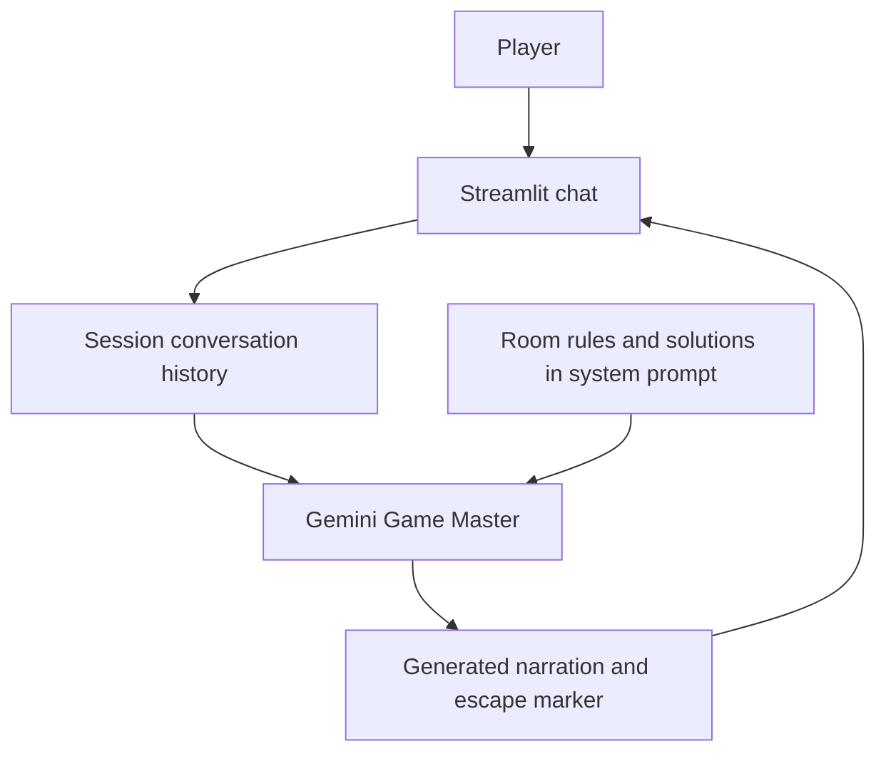
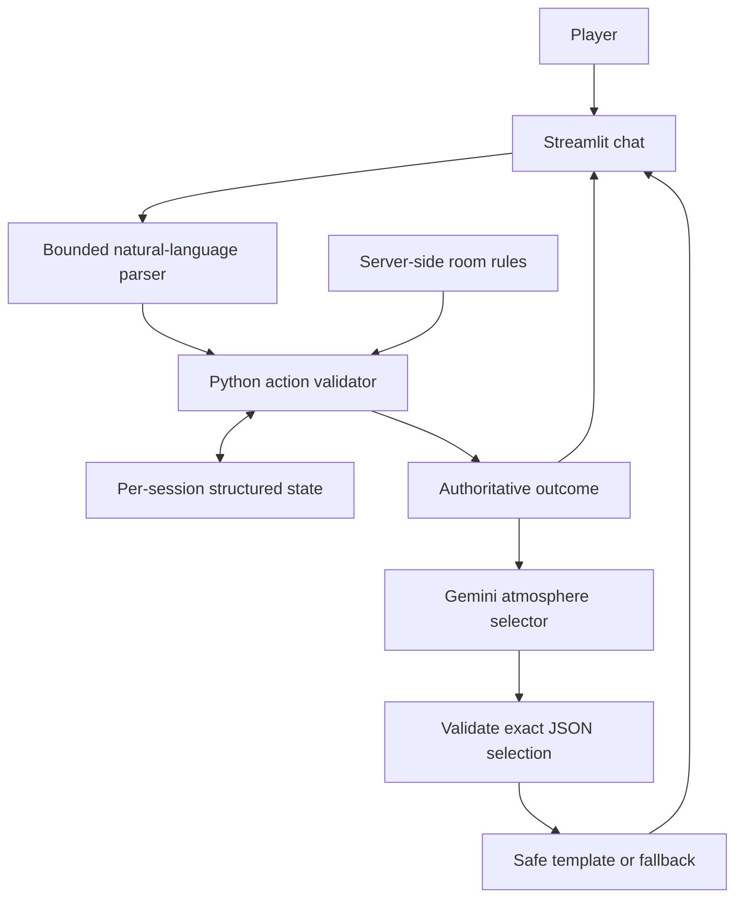

# System architecture

## Version 1: model-owned game

`v1.turn()` sends the full conversation and room rules. Streamlit stores messages
per session. Completion trusts `[ESCAPED]` in the generated answer. The baseline
has no independent inventory or rule validator. Restart clears its history.

## Version 2: Python-owned game

`v2.apply()` is the only game-state writer. It validates action prerequisites
before updating the Python dataclass. The UI completion status comes exclusively
from `State.escaped`. `narrate()` receives the validated outcome and asks Gemini
to select one of three atmospheric sentences. The model's raw text is never
shown. The outcome is always displayed, even on a timeout or malformed response.

The narrator receives neither the raw player instruction nor all puzzle solutions.
An outcome can contain a clue already legitimately revealed by Python. Such a clue
is allowed to reach the narrator. No model output can mutate the Python state.

## Tradeoffs and boundaries

The LLM has a deliberately narrow role in V2. This prevents contradictions at the
cost of less varied prose and limited language understanding. Parser aliases
support common natural language, but arbitrary phrasing and compound actions are
rejected with examples. Pattern matching is a usability choice, not the core
security boundary: Python prerequisites remain authoritative for every action.

Game solutions are in the public repository so a reader can understand the
implementation. This protects gameplay through chat, not secrecy against someone
reading source code. There is no account system, database, multiplayer server,
anti-brute-force lockout or persistence after a session is lost.
