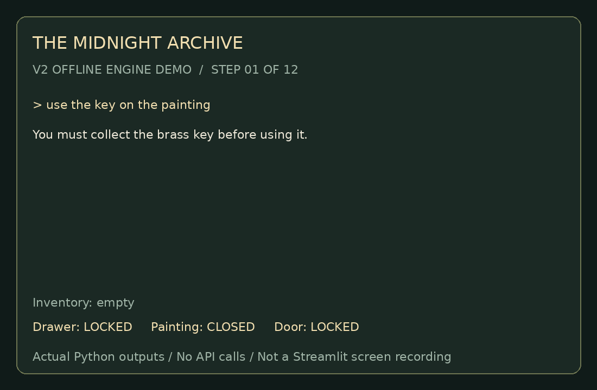

# The Midnight Archive · AI Escape Room

A locked library, five objects, three puzzles and one way out. This course project
compares a conversational LLM game with a game whose rules are enforced in Python.



**Author:** Anish Khobragade. **Stack:** Python 3.11+, Streamlit, Gemini REST API,
requests, python-dotenv, pytest. No model training, GPU or paid API is required.

## What the project solves

An LLM can tell an engaging escape-room story, but it can also forget inventory,
invent objects or accept an instruction to unlock a door. Version 1 delegates
these responsibilities to Gemini. Version 2 maintains explicit game state,
validates actions and keeps completion independent of generated text.

| | Version 1 | Version 2 |
|---|---|---|
| Game authority | Gemini + chat history | Python engine + dataclass |
| Inventory | Model remembers it | Set of collected items |
| Rule checks | System prompt | Explicit prerequisites and exact codes |
| LLM role | Free-text Game Master | Selects approved atmospheric narration |
| Completion | Generated `[ESCAPED]` marker | Python `escaped` flag |
| Outage | Reports error, allows retry | Validated outcome still available |
| Offline play | Not supported | Fully playable, clearly labelled |

## Install and run (Windows PowerShell)

Download or clone the repository, open its folder, then:

```powershell
py -3 -m venv .venv
.\.venv\Scripts\python.exe -m pip install -r requirements.txt
Copy-Item .env.example .env
.\.venv\Scripts\python.exe -m streamlit run app.py
```

This avoids needing to activate the environment or change PowerShell's execution
policy. Open the localhost URL printed in the terminal. Choose Version 2 to play
offline immediately. Use `Ctrl+C` in the terminal to stop the server.

### macOS / Linux

```bash
python3 -m venv .venv
.venv/bin/python -m pip install -r requirements.txt
cp .env.example .env
.venv/bin/python -m streamlit run app.py
```

### Enable Gemini for both versions

Create your own key in [Google AI Studio](https://aistudio.google.com/apikey).
Use a project with free-tier access; do not enable paid billing for this assignment.
Edit **only your local `.env`**:

```dotenv
GEMINI_API_KEY=your_key_here
GEMINI_MODEL=gemini-2.5-flash-lite
```

Restart Streamlit after changing `.env`, then enable **Gemini Game Master** in
the sidebar. Version 1 requires a configured key. Version 2 adds Gemini-selected
atmosphere to its validated outcomes, and falls back to the outcomes on errors.
The app does not automatically detect your billing tier: select a free-tier
project yourself. Free quotas, eligibility and model availability can change.

Provider references: [REST request format](https://ai.google.dev/api/generate-content),
[model and free-tier pricing](https://ai.google.dev/gemini-api/docs/pricing).
Game text is sent to Google when Gemini is enabled; use fictional game actions.

## Play

Explore the desk, bookshelf, painting, drawer and door. Try `look around`,
`I want to examine the desk`, `take the brass key`, `use the key on the painting`,
`open drawer with 123`, `read the card`, `unlock door with 1234`, `inventory`,
`hint` or `help`. The example codes are not solutions. Use one action per message.
The room guide includes all supported command patterns. Unsupported language
returns clarification rather than silently executing part of a message.

Use **Restart game** to clear both versions. Switching versions preserves each
version's separate in-memory transcript. Browser sessions do not share inventory.
There is no permanent save; losing the Streamlit session loses progress.

## Development process

The repository contains genuine staged commits made while implementing this
project: V1 baseline, V2 engine, tests, and documentation. No history was backdated.
The `v1.0` tag preserves the original standalone V1 app. The main branch provides
both versions through a selector; `v2.0` identifies the completed package.

Problems addressed: V1 has no enforceable inventory, code validation or completion
check. A controlled fault-injection test shows that an incorrect model escape
marker can end V1. V2 uses Python prerequisites and structured state, then limits
model output to a validated selection of prewritten atmosphere lines. This
sacrifices free-form storytelling for consistency. No live failure is claimed.

## Evidence and documentation

- [Architecture diagrams](docs/architecture.md): Mermaid diagrams for both versions.
- [Test cases and evidence limits](docs/test-cases.md): 14 documented scenarios.
- [Short report](docs/report.pdf): three-page design and evaluation report.
- [Offline demo](docs/demo.gif) and [actual transcript](docs/demo-transcript.txt).
- [Spoiler walkthrough and explanation guide](docs/walkthrough.md).
- [Validation output](docs/test-results.txt).
- [AI assistance disclosure](docs/AI_ASSISTANCE.md).

```bash
python -m pip install -r requirements-dev.txt
python -m pytest -q
```

GitHub Actions runs the same tests on pushes and pull requests without credentials.
The local automated checks use mocked HTTP responses and Streamlit AppTest.
**Live Gemini tests and screen recordings remain to be completed using your key.**
The GIF shows actual offline engine outputs, not a recorded Gemini session.

## Security and limitations

`.env` and Streamlit secrets are ignored by Git. Only `.env.example` is committed.
Never put keys into chat, screenshots or source. API errors do not print response
bodies or credentials. If a key is ever exposed, revoke it at the provider.

V2 prevents chat instructions and generated narration from writing game state.
It does not hide solutions from source-code readers or prevent brute-force code
guesses. Its bounded parser supports common phrasing, not arbitrary English.
No account system, persistence or multiplayer backend is included. The narrator's
limited role is intentional and should be explained during assessment.

## Submission

Before submitting, run both versions with your own free-tier key, review the code,
record your live observations, and make sure the instructor can access the GitHub
repository. Submit its URL. Do not submit the `.env` file or claim AI-generated
work has already been personally reviewed.
